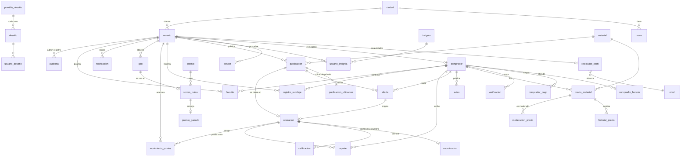

# Base de datos

PostgreSQL 16 + PostGIS, con Prisma. El esquema está en `apps/api/prisma/schema.prisma` y las migraciones en `apps/api/prisma/migrations`.

## Diagrama entidad-relación

Se muestran las tablas principales y sus relaciones. El detalle de columnas está en el esquema.



## Grupos de tablas

| Grupo                 | Tablas                                                                                                                                                                                                     |
| --------------------- | ---------------------------------------------------------------------------------------------------------------------------------------------------------------------------------------------------------- |
| Catálogos             | `ciudad`, `zona`, `material`, `nivel`, `insignia`, `etiqueta_calificacion`, `parametro`, `lista_espera_ciudad`                                                                                             |
| Cuentas               | `usuario`, `sesion`, `codigo_verificacion`, `identidad_externa`, `consentimiento`, `archivo`, `preferencia_usuario`, `suscripcion_push`, `reciclador_perfil`, `reciclador_material`                        |
| Negocios              | `comprador`, `comprador_borrador`, `comprador_horario`, `comprador_pago`, `comprador_foto`, `parada_ruta`, `verificacion`, `precio_material`, `historial_precio`, `moderacion_precio`                      |
| Flujo central         | `publicacion`, `publicacion_ubicacion`, `publicacion_foto`, `oferta`, `operacion`, `coordinacion`, `calificacion`, `calificacion_etiqueta`, `respuesta_calificacion`                                       |
| Confianza             | `reporte`, `favorito`, `busqueda_guardada`, `solicitud_llegada`, `evento_visita`, `aviso`, `notificacion`, `evento_dominio`                                                                                |
| Juego                 | `usuario_insignia`, `plantilla_desafio`, `desafio`, `usuario_desafio`, `movimiento_puntos`, `invitacion`, `giro`, `premio`, `ruleta_configuracion`, `sorteo_ruleta`, `premio_ganado`, `registro_reciclaje` |
| Plan y administración | `solicitud_plan`, `pago_plan`, `auditoria`                                                                                                                                                                 |

## Estados

| Entidad              | Estados                                                                                                      |
| -------------------- | ------------------------------------------------------------------------------------------------------------ |
| Publicación          | DISPONIBLE, CON_OFERTAS, EN_NEGOCIACION, FINALIZADA, CANCELADA, VENCIDA                                      |
| Oferta               | PENDIENTE, ACEPTADA, RECHAZADA, NO_SELECCIONADA, RETIRADA                                                    |
| Operación            | ACEPTADA, EN_COORDINACION, ENTREGADA, CONFIRMADA, COMPLETADA, CANCELADA. La disputa es la marca `en_disputa` |
| Verificación         | EN_REVISION, INFO_PEDIDA, APROBADO, RECHAZADO                                                                |
| Moderación de precio | SOSPECHOSO, CORRECCION_PEDIDA, SUSPENDIDO. Sin fila abierta, el precio no está marcado                       |
| Reporte o incidencia | PENDIENTE, EN_REVISION, CORRECCION_PEDIDA, RESUELTO, DESCARTADO                                              |
| Registro directo     | PENDIENTE, CONFIRMADO, RECHAZADO, VENCIDO                                                                    |
| Plan                 | GRATIS, PRO                                                                                                  |
| Premio ganado        | POR_RECLAMAR, ENTREGADO, VENCIDO                                                                             |

La base de datos rechaza las transiciones no permitidas de publicación, oferta y operación.

## Reglas que impone la base de datos

| Regla                                                                                     | Cómo                                                          |
| ----------------------------------------------------------------------------------------- | ------------------------------------------------------------- |
| El precio es un rango obligatorio, con mínimo menor o igual al máximo                     | Columnas obligatorias y restricciones                         |
| El precio por kg está entre los límites vigentes (S/ 0.10 y S/ 50.00)                     | Disparador que lee `parametro`                                |
| Solo el dueño del negocio fija o cambia sus precios                                       | Disparador: el autor debe ser el usuario dueño                |
| Cada cambio de precio queda en el historial con su autor                                  | Disparador; nadie escribe el historial directamente           |
| La demanda es independiente del precio                                                    | Columna aparte; cambiarla no altera el precio ni el historial |
| Una operación por publicación y por oferta                                                | Claves únicas                                                 |
| Una oferta vigente por negocio y publicación; no se vuelve a ofertar tras un rechazo      | Índice único parcial                                          |
| El total de una oferta es precio por kg × kilos                                           | Disparador                                                    |
| Una calificación por autor y operación, solo tras operación completada y entre sus partes | Clave única y disparador                                      |
| Un movimiento de puntos por operación y motivo                                            | Clave única                                                   |
| Solo los puntos por reciclaje cuentan para giros                                          | Restricción                                                   |
| Un registro directo no se duplica para el mismo negocio, material y fecha                 | Índice único parcial                                          |
| Una operación en disputa no se completa hasta resolverse                                  | Restricción y disparador                                      |
| Auditoría, sorteos e historial de precios solo admiten insertar y leer                    | Permisos y disparador                                         |

## Usuarios de base de datos

| Usuario              | Para qué                 | Restricciones                                                                                                                                                                              |
| -------------------- | ------------------------ | ------------------------------------------------------------------------------------------------------------------------------------------------------------------------------------------ |
| `reciclomap` (dueño) | Migraciones y semilla    | —                                                                                                                                                                                          |
| `rm_api`             | Uso general de la API    | No puede leer `publicacion_ubicacion` (solo insertar). No puede escribir `historial_precio`. No puede actualizar ni borrar `auditoria`, `sorteo_ruleta` ni `ruleta_configuracion`          |
| `rm_admin`           | Módulo de administración | Todo lo anterior y además: solo lectura sobre `precio_material`; en `operacion` solo puede cambiar el estado y la disputa, nunca los kilos ni el monto; no puede pedir tramos de distancia |

## Ubicación y distancia

- La ubicación de una publicación vive en `publicacion_ubicacion`, separada de la publicación.
- La API nunca la lee. La distancia se obtiene con dos funciones que devuelven únicamente una de estas etiquetas: `menos de 1 km`, `1–2 km`, `2–5 km`, `más de 5 km`.
  - `publicacion_tramo(publicacion, comprador)`
  - `publicaciones_cercanas(comprador)`: publicaciones abiertas de la ciudad del negocio dentro del radio máximo.
- El punto de referencia de un negocio es fijo: la ubicación del centro o el centro de la zona de trabajo del comprador móvil.
- La vista `v_mapa` reúne negocios verificados con sus precios visibles.

## Datos semilla

`pnpm db:sembrar` carga datos ficticios de Juliaca: 5 ciudades (solo Juliaca activa), 12 zonas, 5 materiales, 6 niveles, 12 insignias, etiquetas de calificación, 6 plantillas de desafío con la Meta del mes, 8 premios, los parámetros iniciales, 5 centros de acopio, 5 compradores móviles, un reciclador de ejemplo y una cuenta de administración.

Los teléfonos usan el rango 900 000 0xx y los correos terminan en `.test`, para que no correspondan a nadie. Las coordenadas son aproximadas y de ejemplo. Las cuentas aún no tienen contraseña: se agregan con el módulo de acceso.

## Cómo crear una migración nueva

1. Cambia `schema.prisma`.
2. Genera la migración sin aplicarla:

   ```bash
   pnpm --filter @reciclomap/api exec prisma migrate dev --create-only --name nombre_del_cambio
   ```

3. Revisa el SQL generado. Si el cambio necesita restricciones, disparadores, funciones o permisos, añádelos en ese mismo archivo.
4. Aplica con `pnpm db:migrar` y ejecuta `pnpm db:probar`.

Notas:

- Las tablas nuevas reciben permisos para `rm_api` y `rm_admin` de forma automática. Si una tabla nueva es sensible, retira en la migración los permisos que no correspondan.
- Una migración ya compartida con el equipo no se edita: se crea otra.
- Solo una rama con migraciones a la vez, para evitar conflictos.
